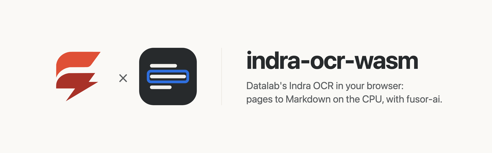
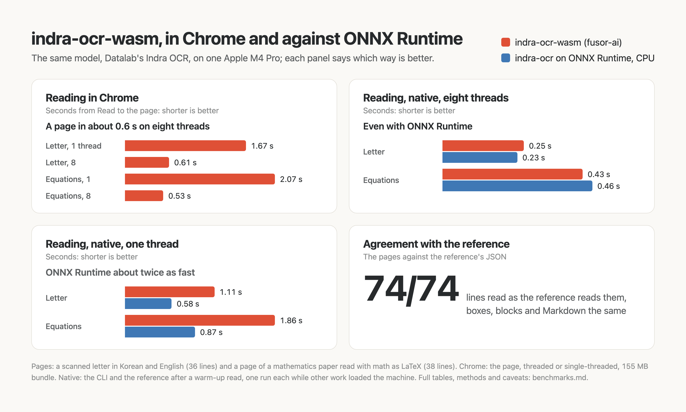

<p>
  <picture>
    <source media="(prefers-color-scheme: dark)" srcset="assets/brand/banner-dark.png">
    
  </picture>
</p>

# Pages to Markdown in the browser, on the CPU

Drop, paste or pick an image of a page and get it back as Markdown, with every line's box and text and the page's layout blocks: Datalab's [Indra OCR](https://huggingface.co/datalab-to/indra-ocr), a pipeline of small networks that reads printed and handwritten pages in 80+ languages, at any angle, computed on your own device. No server, no API key, no GPU required, and once the model has loaded, no page leaves the browser.

indra-ocr-wasm is the app around the model: a [fusor](https://github.com/fusor-rs/fusor) page, the browser runtime and a native CLI. The model itself, compiled to WebAssembly, is built with [fusor-ai](https://github.com/fusor-rs/fusor-ai), the toolkit for AI runtimes in Rust and WebAssembly, from the published networks.

**In development · v0.1**: this is experimental software. See [status and known limitations](#status-and-known-limitations).

[Run it](#run-it-locally) · [How it works](#how-it-works) · [How fast is it](#how-fast-is-it) · [Benchmarks](benchmarks.md) · [Status](#status-and-known-limitations)

## Run it locally

You need Rust 1.99 or newer, installed with [rustup](https://rustup.rs), Node.js 22 or newer and [`just`](https://github.com/casey/just). Then:

```sh
git clone --recurse-submodules https://github.com/fusor-rs/indra-ocr-wasm && cd indra-ocr-wasm
just ui
```

and open the address it prints. `just ui` installs the pinned tools (the threads toolchain with rustup; wasm-bindgen, binaryen and the fusor CLI into `.tools/`), downloads the checkpoint at a pinned revision (92 MB, each file sha256-checked), compiles it into a 155 MB bundle, builds the four browser runtimes (a few minutes the first time, seconds after) and the page, and serves it on `http://localhost:8787` with the bundle beside it.

Drop an image of a page on the page, paste one, or choose a file; tick **Read math as LaTeX** if it holds formulas, and press **Read**, even while the model is still loading: the page is read the moment the model is ready. The page comes back as Markdown, drawn as you would read it: headings, paragraphs and lists, tables as tables, formulas typeset with KaTeX, with the Markdown and every line and its confidence below to copy, and the lines and blocks outlined on the image. Every reading is measured live: the time from Read to the page, its lines and blocks, the batches of lines through the recognizers, the turn and tilt undone, and the network requests since the model loaded, which stay at zero.

## More ways to run it

### Build everything from source

```sh
just build    # also downloads the checkpoint (92 MB, sha256-checked) and compiles the bundle
just serve
```

`CHECKPOINT=<dir>` reuses a checkpoint you already have.

### The CLI

The CLI reads the pages of a JSON file without a browser and writes each as the reference's JSON (`--format json`) does:

```sh
target/release/indra-ocr read dist/model fixtures/pages.json --images fixtures/images
```

`indra-ocr bench` measures each stage on a page and `indra-ocr parity` compares every network call and pipeline step with the reference's.

## How it works

- **The reference's pipeline, step by step.** A preview of the page, the tilt that makes its ink rows sharpest (searched over ±45°), and an orientation network that tells a page turned a quarter or a half turn, or set in vertical columns; the page turned and straightened; a line detector whose core map's regions become line boxes, read again at a larger scale when the lines come out small; each line cut out with the page around it and routed by a script classifier to its recognizer (base, CJK, right-to-left or world); CTC decoding, and on unsure lines a beam search with the recognizer's n-gram language model; lines with math read again by an encoder-decoder into LaTeX; lines split at wide gaps and at column gutters, list markers joined to their items; and a reading-order network over every line's box and text, whose heads give the order, the layout blocks and their classes, written as Markdown.
- **The reference's pixels, exactly.** Every image the networks read is bit-exact with the reference's: the page's grayscale, its area and linear resizes, rotations and quarter turns reproduce OpenCV 5's arm64 build, its generic code and its carotene layer, rounding included. So the two fixed pages read exactly as the reference reads them, every line, box, block and the Markdown.
- **Small networks, f32.** The detector and the orientation network are inverted-residual convolutional networks, the recognizers stacks of depthwise blocks with squeeze-excitation over the line's steps, the order network a 4-layer transformer, the math reader a convolutional encoder with attention and a 3-layer decoder with cached keys and values: 7.3 million parameters without the math models, every weight in f32 as in the checkpoint.
- **One batch per step.** The engine worker reads in steps (the page turned upright, its lines found, then one batch of lines of similar width at a time) and posts each, so the page shows the progress and Stop takes effect between batches.
- **Threads and SIMD where the browser has them.** The page picks one of four builds: worker threads when it is cross-origin isolated, relaxed SIMD when the engine supports it, plain SIMD128 everywhere else.
- **Downloaded once, verified always.** The bundle streams in parts, each checked against its BLAKE3 hash, and stays in the browser's origin-private storage, so the next visit loads from this device in a fraction of a second.
- **Sealed.** The runtime imports no network, storage, clock or entropy capability; fusor-ai's import check proves it on every build. The page counts its network requests while it reads, and the count is zero.

## How fast is it

On an Apple M4 Pro in Chrome on eight threads, the page reads a scanned letter in Korean and English in 0.61 s and a page of a mathematics paper, its math as LaTeX, in 0.53 s; on one thread, in 1.7 s and 2.1 s. Natively on eight threads it is even with the reference on ONNX Runtime; on one thread ONNX Runtime is about twice as fast. Both pages read exactly as the reference reads them. [benchmarks.md](benchmarks.md) has the full measurements:

<picture>
  <source media="(prefers-color-scheme: dark)" srcset="assets/benchmarks/benchmarks-dark.png">
  
</picture>

## Documentation

| Guide | Covers |
| --- | --- |
| [Benchmarks](benchmarks.md) | Time to the page, agreement with the reference and download, and how to reproduce them |
| [AGENTS.md](AGENTS.md) | The code standard every change follows |

## Status and known limitations

indra-ocr-wasm is v0.1 and experimental.

| Platform or capability | Status |
| --- | --- |
| Chrome and Edge, threads and relaxed SIMD | Headless Chrome end-to-end check (`just e2e`): read while loading, a page with math, revisit |
| Browsers without relaxed SIMD (Safari, older Firefox) | SIMD128 builds, checked in Node (`just smoke`); not tested in those browsers |
| Pages without cross-origin isolation | Single-threaded builds: about 2 s a page on an Apple M4 Pro |
| Native CLI (macOS on Apple silicon) | Built and measured; no release archives yet |
| Phones | Not measured |

**Not supported yet:**

- PDFs: the reference reads a PDF's text layer and renders its pages to images; here the page reads images. Render a PDF's pages to images first.
- The reference's table heads (`--table-heads`), its page headers and footers kept in the Markdown (`--keep-furniture`), and multi-page TIFFs.
- The checked pages read bit for bit as the reference does on arm64 (macOS on Apple silicon, Linux on aarch64), whose OpenCV builds the image steps follow; OpenCV's x86 builds resize some images a gray level differently.
- A smaller download: the language models' tables are stored unpacked (107 MB of the 155).
- A GPU backend.

The model is Datalab's [Indra OCR](https://huggingface.co/datalab-to/indra-ocr), its weights under a modified [OpenRAIL-M license](https://huggingface.co/datalab-to/indra-ocr/blob/main/LICENSE) with use restrictions (free for research, personal use and startups under a funding or revenue threshold, and not for competing with Datalab's API); the bundle ships it beside the weights (`model/LICENSE`). The test pages are Indra's own samples ([datalab-to/indra](https://github.com/datalab-to/indra), Apache-2.0), downloaded at a pinned commit.

## License

The code is licensed under the [MIT License](LICENSE). The model's weights are Datalab's, under a modified [OpenRAIL-M license](https://huggingface.co/datalab-to/indra-ocr/blob/main/LICENSE).
